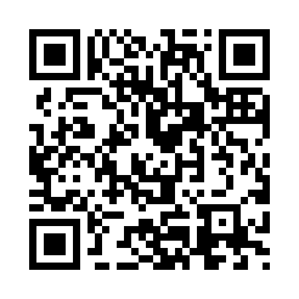

AbyssBeacon
Search deeper. Find models sooner.

A local model discovery and download manager for Hugging Face, CivitAI, CivitAI Red, ModelScope, TensorHub Art, and SeaArt.

AbyssBeacon brings multiple model sources into one local interface so you can find new releases, track updates, inspect previews and metadata, follow creators, and manage downloads without checking each site individually.

Download the latest release · Join the Discord · Report a bug
Features
- Scan multiple supported model sources from one interface.
- Track new, updated, viewed, favorite, and downloaded models.
- Filter by source, architecture, model type, access state, favorites, and download status.
- Combine several architectures in one feed filter.
- Choose sources, architectures and model types using compact collapsible scan controls.
- View Hugging Face and ModelScope collection READMEs without leaving AbyssBeacon.
- Switch source/version details and inspect clearly scoped popularity statistics.
- Browse model images and video previews.
- Search supported sources directly without changing the normal scan registry.
- Import a model or scan a creator by pasting a supported page URL.
- Use Discovery scans and creator tools to find models outside normal architecture searches.
- Track downloadable, gated, paid, and early-access states where the source provides enough information.
- Download through the browser or use the Local Installer for a ComfyUI model library.
- Pause and resume supported local downloads, including across AbyssBeacon restarts.
- Keep model information and preview images beside locally installed models.
- Configure scan limits and retention windows to control how deeply sources are searched.
- Hide mature content by default, with user-controlled visibility settings.
- Block creators from individual sources or use supported universal creator exclusions.
- Run locally with a SQLite database and local settings.

Supported Sources
Source	Normal Scan	Search / Discovery	Downloads
Hugging Face	Yes	Yes	Yes
CivitAI	Yes	Yes	Yes
CivitAI Red	Yes	Yes	Yes
ModelScope	Yes	Yes	Yes
TensorHub Art	Yes	Yes	Yes
SeaArt	Yes	Yes	Source-dependent

Source websites, APIs, authentication requirements, and page structures can change without notice. A source may temporarily require an AbyssBeacon update if its service changes.
Supported Architectures
The built-in scan options currently include:
Family	Scan options
MOSS	MOSS Image (SFT), MOSS Image Base
Qwen	Qwen Image 2.1
Fibo	Fibo 2.0 Dev, Fibo 2.0 Edit Turbo
Krea	Krea 2
MiniMax	MiniMax-H3
FLUX.3	FLUX.3, FLUX.3 Klein, FLUX.3 Klein Base
FLUX.2	FLUX.2 Klein 4B, FLUX.2 Klein 9B
WAN	WAN 2.2
Z-Image	Z-Image Turbo, Z-Image Base
LTX	LTX-2.5
Other families	Anima, Illustrious, Pony, SDXL

Availability varies by source; an architecture being listed does not mean every site has matching models or a supported scan category.
- MOSS Image is the SFT variant. SeaArt supports this option; MOSS Image Base is scanned separately on supported sources and is not enabled on SeaArt.
- Fibo 2.0 Dev and Fibo 2.0 Edit Turbo discovery is currently enabled for Hugging Face and ModelScope.
- Krea 2 scans include regular and Turbo categories on CivitAI and CivitAI Red.
You can select several architectures in one scan or combine them in the feed filter. Screenshots illustrate the interface and may show fewer options than the current version.
Getting Started
Requirements
- Windows
- Python 3 available from the command line
- Internet access
- Firefox, Chrome, or Microsoft Edge if you use the SeaArt browser-session connection
Windows is the tested platform for the initial release.
Start AbyssBeacon
1. Download or clone the repository.
2. Open the AbyssBeacon folder.
3. Double-click AbyssBeacon.bat.
4. On first launch, AbyssBeacon creates a local Python virtual environment and installs the packages listed in requirements.txt.
5. Open http://127.0.0.1:5000 in your browser when the terminal says AbyssBeacon is ready.
The first startup can take longer while Python packages are installed.
First Run
Fresh installations start with conservative defaults:
- All supported sources and tested model families are available.
- CivitAI is preselected for the first scan. Other sources are available but remain unchecked until you enable them. All tested model families are preselected.
- Normal scans use a global maximum of 150 results per source and architecture search.
- Automatic Retention is off by default.
- Mature models are hidden by default.
- Downloads use the browser by default.
- The Local Installer has no ComfyUI folder configured until you choose one.
Open Settings to change these defaults before your first large scan.
Scanning
Use the SCAN button to choose the sources and model families for a normal scan.

AbyssBeacon supports centralized scan limits:
- A finite result limit stops a source and architecture search at that result ceiling.
- If Automatic Retention is enabled, the scan stops at the result limit or retention-day boundary, whichever comes first.
- Unlimited result mode uses the retention window as the stopping boundary.
- Individual sources can use lower limits than the global setting.
Individual services can still impose their own backend or pagination limits.
Search Sources and Discovery
Normal scans use the tested model-family definitions configured in AbyssBeacon.

The main search box filters models already in your AbyssBeacon feed.

Use Search Sources when you want to look for an arbitrary model name or keyword without adding it to the normal scan registry. Type search in the main search box to open Search Sources.

Choose Import / scan by URL in Search Sources to paste a supported model or creator page. AbyssBeacon detects the source and uses its normal lookup and account connection. Direct model links are imported independently of the architecture selection; creator imports use the selected result limit and source limits. Some sources require a connected account.

See Supported Architectures for the built-in scan options and source-specific notes.

Discovery tools can use source-specific tags and creator information to find models outside the normal architecture searches. Type discover in the main search box to open Discovery.

MiniMax-H3 discovery on Hugging Face combines name, tag, and base-model searches. Broad search hits are checked against architecture evidence before import, so unrelated MiniMax models are not assumed to be H3.

Fresh installations use Hugging Face's combined creation/update activity ordering. Existing saved source-sort preferences remain unchanged when updating.

Models remain New when you open them or visit a collection. Use Mark Visible as Seen to clear the New status of models currently on screen, or Mark All as Seen to clear all New models in the library. Returning from a creator or collection restores your feed filters and location.

Additional explanations are available by hovering over controls inside AbyssBeacon.
Downloads and ComfyUI
The default download behavior sends files to your browser.

To use the Local Installer:
1. Open Settings.
2. Go to Library.
3. Set your ComfyUI folder.
4. Choose Install to local library as the download behavior.
The default Local Installer layout is:

AbyssBeacon / model

AbyssBeacon keeps original filenames by default and keeps both files if an older version already exists.

When enabled, model info and preview images are saved beside installed models.
SeaArt
SeaArt discovery uses a local browser session because its website signs requests in the frontend.

AbyssBeacon can launch an isolated local browser profile for this connection. Firefox is the default browser choice. The saved browser profile stays on your machine and is excluded from the repository by .gitignore.
Privacy and Local Data
AbyssBeacon is designed as a local application.

Local runtime data can include:
- models.db
- settings.json
- secrets.json
- browser-session profiles
- cached previews
- download state
The public repository excludes credentials, browser profiles, databases, caches, partial downloads, and other machine-specific runtime data.

If you add source credentials, they remain local unless you deliberately copy or publish those files yourself.
Mature Content
Fresh installations default to Hide Mature.

Users can change mature-content visibility in Settings. Source metadata is not always consistent, so no automated classification should be treated as perfect.
Current Scope
AbyssBeacon is focused on discovering, tracking, inspecting, and downloading models from the currently supported sources.

The first public release is Windows-focused and has been built primarily around local ComfyUI workflows. Source integrations may need maintenance as third-party websites and APIs change.
Reporting Problems
Join the AbyssBeacon Discord for discussion, feedback, and feature ideas. For bugs, please open a GitHub Issue so reports and fixes stay easy to track.

If something breaks, an issue is most useful when it includes:
- the source being scanned
- the model or creator involved, when relevant
- what you expected to happen
- what happened instead
- terminal output around the failure
- a screenshot when the problem is visual
Do not post API keys, cookies, session tokens, passwords, or your secrets.json file in a public issue.
Project Status
AbyssBeacon is actively developed. This is the first public release, so issues may still appear, especially in integrations that depend on third-party websites and APIs.
Support AbyssBeacon
AbyssBeacon is a free, open-source project that I work on in my spare time. If it has been useful to you and you'd like to support continued development, anything helps and is greatly appreciated.

  

- $1 - It helped a little
- $5 - Pretty useful
- $10 - Huge time saver
- Custom amount - Game changer
There's absolutely no obligation to donate. Using AbyssBeacon, reporting bugs, suggesting improvements, or simply sharing the project helps too.
License
AbyssBeacon is licensed under the GNU General Public License v3.0 only (GPL-3.0-only).

You may use, study, modify, and redistribute the project under the terms of GPL-3.0. If you distribute a modified version or other derivative covered by the GPL, the corresponding source must remain available under the GPL terms.

The GPL does not prohibit charging money for copies or distributions. It does require distributed GPL-covered derivatives to preserve the license and source-code freedoms.

See LICENSE for the complete license text.

Copyright (C) 2026 AbyssBeacon contributors.
Source statistics and scan targeting
Source-colored version pills select the matching About text, gallery and dates.
Pills use your saved source colors. Matching CivitAI/Red versions share one pill,
colored for the source with more version downloads; both sources' counts appear
inside the existing Downloads and Likes boxes. SeaArt's generic Current version
label is displayed as SeaArt. Version selections use version counts/dates when available. Values
that only describe a provider listing are labelled accordingly; missing version
counts are unavailable rather than borrowed from the complete listing.

Most Downloads/Most Likes sort matching architecture versions before pagination.
Each version is counted once within its provider. Merged cards use the highest
eligible provider count, without adding mirror totals. Missing version statistics
sort last. Use Options > Library > Update Library to fill missing saved
CivitAI/Red version statistics and dates. It uses stored data first, then targeted
requests to the same provider. Temporary failures remain pending for retry;
unavailable versions are marked checked without erasing old data. A source that
fails is paused for that update run. A model Reload remains available for
fresh full details. Some providers do not publish every metric. Provider popularity
figures can also cover different reporting periods.

The SCAN dialog has collapsible Sources, Models to Scan and Model types sections,
with selected counts and Select All/Clear controls. Model types default to all;
clearing the type selection requires choosing a type before scanning. Normal
scans retain their existing result limits and automatic retention/day boundaries.
The experimental custom lookback controls have been removed from normal scans,
keyword search and tag discovery. Exact URL imports retain their existing behavior.
Updating an existing library
Options > Library > Update Library applies pending metadata upgrades. Large
libraries may take several hours, especially older CivitAI/Red cards needing
individual version-statistics requests. Keep AbyssBeacon running and prevent
sleep until completion. Successfully upgraded entries do not need the same
upgrade again; when no upgrades remain, the action is unavailable. This metadata
refresh does not apply the optional existing-library merge proposals.
